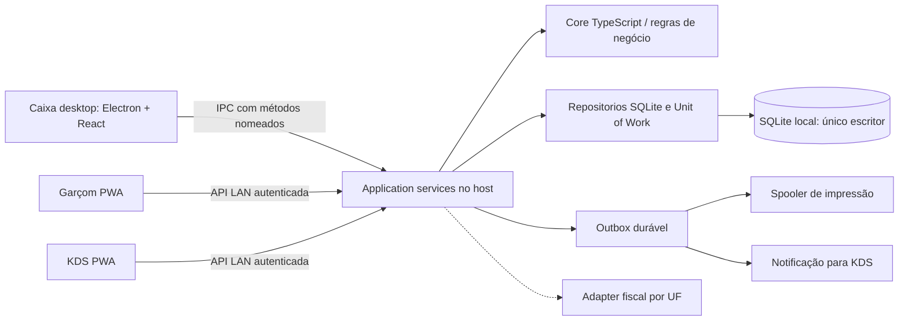

# Arquitetura — PDV Nexus 2.0

## Objetivo

Atender restaurantes e lanchonetes em operação contínua mesmo sem internet no **caixa host**, começando pelo balcão. Mesas, comandas, KDS e garçons usam a mesma entidade `Order` com `serviceMode` (`counter`, `table`, `takeaway`, `delivery`).

## Fronteiras

- **Frontend**: React + TypeScript (Vite), telas mobile-first, responsivas, sem acesso direto a arquivos/dispositivos/banco.
- **Desktop**: Electron com `contextIsolation=true`, `sandbox=true`, `nodeIntegration=false`, bridge preload allowlisted e CSP restritiva; validar todos os comandos IPC no host.
- **Serviço de aplicação**: serializa comandos, valida permissões, autentica dispositivo/operador e inicia transações.
- **Domínio**: sem dependência do Electron, React, SQL, HTTP ou bibliotecas de impressão.
- **Persistência**: SQLite `foreign_keys=ON`, WAL, migrations versionadas; por restaurante, um banco gerenciado exclusivamente no host (nunca compartilhar arquivo .sqlite via rede).
- **PWA LAN**: acesso seguro ao host por pareamento do dispositivo. Se o host cair, clientes LAN não podem gravar; offline de terminais secundários exige protocolo separado de sincronização futura.
- **Hardware**: adapters por protocolo, fila persistente, retentativas auditadas; imprimir não determina sucesso ou fracasso da venda.
- **Fiscal**: módulo opcional de infraestrutura mas **obrigatório quando exigido pela operação legal**; cupom não fiscal não substitui documento fiscal.

## Comando transacional esperado (a implementar em M0.2/M1)

1. Aplicação recebe `commandId`, `orderId`, `expectedRevision`, payload validado e operador.
2. Verifica autorização e idempotência: mesmo `commandId` + mesmo hash devolve resposta gravada; hash diferente retorna conflito.
3. `BEGIN IMMEDIATE`; lê o aggregate; confere revisão; aplica regra no core.
4. Grava pedidos/linhas/pagamentos + auditoria + `command_receipt` + eventos de outbox **na mesma transação**.
5. `COMMIT`; responde ao solicitante; worker independente tenta emitir impressão/KDS/fiscal conforme política de operação.
6. Cliente com timeout consulta o resultado pelo `commandId`, não repete venda com ID novo.

## Regras de modelagem

- Identificadores globais não sequenciais (UUID), revisões inteiras para concorrência.
- Valores monetários em centavos, inteiros seguros, sem float; descontos, adicionais e taxas precisarão de snapshots próprios.
- Linha de pedido registra nome/preço histórico, para não recalcular vendas antigas ao editar cardápio.
- KDS tem estado próprio por ticket/item; não usar `status` do pedido para representar preparo.
- Mesas são alocação, não titularidade financeira: pagamentos continuam vinculados a pedidos, com rateio e conciliação explícitos.
- Fechamento de caixa é registro financeiro separado do total do pedido, com sangria/suprimento/operador e auditoria.
- Estoque por razão de movimentos, não atualização arbitrária de saldo; receitas/fichas técnicas em módulo posterior.
- Não enviar documentos pessoais, pagamentos ou dados de vendas para serviços externos por padrão.

## Riscos e validações

| Risco | Estratégia |
|---|---|
| Duas estações finalizam o mesmo pedido | revisão + transação + chave idempotente |
| Falha de energia no checkout | transação ACID e recovery do SQLite |
| Impressora offline | outbox/fila com retries e deduplicação de impressão quando possível |
| Wi-Fi indisponível | caixa host segue local, PWA avisa indisponibilidade |
| Corrupção/perda do equipamento | backups consistentes, retenção e restauração testada |
| Alterações fiscais ou hardware incompatível | adapters desacoplados e validação por UF/modelo |
| Exposição da API LAN | pareamento, permissão, autenticação, bind/configuração controlados |

## Não escopo de M0.1

Não há API, interface, gravação de pedidos, regras fiscais, sincronização entre unidades, impressão ou backup implementados. O schema é inicial e não substitui testes de integração ao implementar o repositório SQLite.
